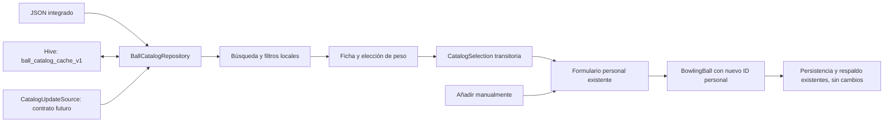

# Fase B — base local del catálogo comercial

## Auditoría y decisión de compatibilidad

«Mis bolas» usa Provider, `DataRepository` y Hive. El inventario se lista en
`mis_bolas_screen.dart`, se crea/edita en `editar_bola_screen.dart` y se consulta
en `detalle_bola_screen.dart`. El selector de partidas utiliza el ID personal.
`Partida.ballId` y `BallMaintenance.ballId` apuntan a esa unidad, no a un modelo
comercial. Las estadísticas se calculan con esas referencias existentes.

`BowlingBall` utiliza typeId 19 y campos Hive 0–10. `BallMaintenance` utiliza
typeId 20. La fase A respalda exactamente el JSON personal actual: sus reglas
Firestore incluyen `hasOnly` para esos campos. Añadir ahora `catalogId`, una
imagen o especificaciones al JSON personal sería incompatible con las reglas
y alteraría el respaldo, prohibido en este alcance.

Por ello, la primera integración es una **precarga transitoria** del formulario.
Se copian nombre, fabricante, peso, cubierta y acabado a los campos personales
ya existentes. Al guardar, la ruta habitual crea una nueva `BowlingBall`, con ID
propio. Notas, compra, estado y futuras modificaciones siguen siendo personales.
El catálogo no cambia una bola existente ni intenta identificarla por nombre.
No se ha modificado ningún modelo/adaptador personal, servicio de respaldo,
repositorio del arsenal, referencia de partida/mantenimiento ni regla Firebase.

No se persiste aún un vínculo permanente al ID comercial ni sus fotografías en
el arsenal. Tampoco se incrustan metadatos en notas. Ese paso requerirá una
propuesta independiente de compatibilidad y respaldo. En esta fase las imágenes
pertenecen al catálogo; las tarjetas personales conservan su representación
actual. Dos unidades del mismo producto mantienen IDs e historiales diferentes.

## Arquitectura



### Archivos existentes modificados

- `pubspec.yaml`: solo registra dos assets JSON; no añade dependencias.
- `lib/main.dart`: proporciona un repositorio de catálogo compartido con Provider.
- `lib/screens/mis_bolas_screen.dart`: ofrece catálogo o alta manual y recarga
  el arsenal después de guardar, con control de cambio de cuenta.
- `lib/screens/editar_bola_screen.dart`: admite precarga al crear, preservando
  la edición existente. La analítica opcional no bloquea un guardado correcto;
  se rechazan pesos no finitos en el formulario.

### Archivos nuevos

- `lib/models/catalog_ball.dart`: producto, fuentes, imagen, pesos y snapshot.
- `lib/models/catalog_selection.dart`: selección transitoria para precargar.
- `lib/repositories/ball_catalog_repository.dart`: lectura, caché, búsqueda,
  validación e instalación de snapshots; contrato de actualización sin servidor.
- `lib/screens/ball_catalog_screen.dart`: búsqueda, filtros y demostración.
- `lib/screens/catalog_ball_detail_screen.dart`: ficha, procedencia y peso.
- `lib/widgets/catalog_ball_image.dart`: imagen autorizada o alternativa visual.
- `assets/catalog/catalog_seed.json`: catálogo comercial inicial **vacío**.
- `assets/catalog/catalog_demo.json`: tres productos **ficticios**, sin fotos.
- `docs/schemas/ball_catalog_v1.schema.json`: esquema JSON documentado.
- Pruebas: `catalog_ball_test.dart`, `ball_catalog_repository_test.dart`,
  `catalog_flow_test.dart` y su helper `support/catalog_fixtures.dart`.

## Esquema y desconocidos

El snapshot tiene `schemaVersion`, `version`, `updatedAt` UTC, `isTestData` y
`balls`. Cada producto contiene:

| Datos | Representación |
| --- | --- |
| Identidad | `id` comercial estable, fabricante, modelo y alias |
| Situación | `releaseYear` nullable; `current`, `discontinued` o `unknown` |
| Cubierta/núcleo | Tipo y material de cubierta; nombre/tipo de núcleo nullable |
| Superficie | Acabado de fábrica nullable, distinto de posteriores cambios personales |
| Pesos | Lista de pesos nominales, cada uno con RG, diferencial y diferencial intermedio nullable, en pulgadas |
| Variantes de núcleo | Nombre/tipo opcionales por peso, prevalecen sobre la descripción general al consultar ese peso |
| Ficha | URL oficial HTTPS nullable |
| Foto | URL, fuente, titular, licencia, URL de licencia o referencia de permiso, fecha UTC de revisión y autorizaciones de visualización/caché |
| Procedencia | Fuentes identificadas y revisadas, más `fieldSources` para atribución por campo |
| Actualización | Fecha UTC y clasificación explícita como prueba o comercial |

`null` significa desconocido/no publicado, no cero. No se extrapolan valores de
un peso a otro ni se asigna un peso por defecto. Si no hay pesos comerciales
conocidos, se permite introducir el peso personal sin inventar especificaciones.
Un año de lanzamiento no ficticio exige una referencia de procedencia para ese
campo. El validador rechaza IDs o pesos duplicados, métricas inválidas, referencias
rotas, mezcla de datos reales y ficticios, URLs inseguras y esquemas desconocidos.

El JSON Schema es documentación de intercambio; el validador Dart es el que se
ejecuta en la app y añade verificaciones entre registros. No se ha instalado un
validador externo ni se afirma que la app ejecute el estándar JSON Schema entero.

## Caché, versiones y actualización

El catálogo tiene una caja pública y separada `ball_catalog_cache_v1`, con JSON
en un único registro, sin adaptadores ni typeId nuevos. No contiene cuentas ni
referencias personales y no participa en logout, importación de invitado o
respaldo. Los consumidores no tienen formularios para editar el catálogo.

Al abrir, se valida el JSON integrado y se utiliza una caché compatible más
reciente si existe. Una caché corrupta no se borra: se avisa y se recurre al asset.
Las búsquedas operan sobre el snapshot cargado, sin consultas por tecla ni red.
La búsqueda normaliza mayúsculas, espacios y acentos; combina fabricante, modelo,
alias, filtro de fabricante y estado.

Las actualizaciones se serializan. Se valida todo el snapshot antes de guardarlo
y activarlo. No se permite retroceder de versión ni cambiar contenido usando la
misma versión. Una descarga o escritura fallida conserva el snapshot activo.
El contrato `CatalogUpdateSource` permite incorporar después un origen HTTP
aprobado. **No hay URL, transporte HTTP de catálogo, temporizador ni publicación
configurados en esta entrega.** No se consulta ninguna web externa al abrirla.

Una vez aprobado e integrado un alojamiento y su transporte, nuevos modelos con
el mismo esquema podrán distribuirse cambiando los JSON, sin una APK por modelo.
El salto de esquema o la integración inicial del transporte sí puede exigir una
actualización de la app. El alojamiento, autenticidad del manifiesto, política de
firmas/checksums, límites de descarga y frecuencia de refresco requieren diseño
final antes de activar actualizaciones remotas.

## Fuentes, derechos y mantenimiento editorial

No se descargaron catálogos reales, no se hizo scraping y no se copiaron fotos.
La estrategia pendiente es acordar suministro de fichas/JSON/CSV con fabricantes
o proveedores que autoricen su reutilización. Publicación de una web o acceso
gratuito a una API no se consideran permiso de redistribución.

Antes de incorporar un modelo real: identificar variante/mercado y ficha oficial,
verificar medidas por peso y fechas, registrar fuente y revisión, dejar ausentes
los datos no publicados, y revisar derechos de imágenes por separado. Después:
validar snapshot, incrementar versión, publicar en alojamiento aprobado y activar
su manifiesto. Conservar versiones anteriores para revisión; no reutilizar IDs
para otro producto ni borrar modelos solo por estar descatalogados.

La imagen solo se solicita si la metadata incluye una autorización de exposición,
titular, licencia, fuente y evidencia de permiso revisada. Esto es una atestación
editorial: **el código no verifica jurídicamente una licencia por visitar una URL**.
No se utiliza ninguna fotografía real en este alcance. Si falta autorización o
falla la descarga, aparece un icono alternativo.

La visualización utiliza la caché transitoria normal de Flutter; no se implementa
todavía una caché persistente de fotografías. Antes de añadirla se deberá exigir
permiso de almacenamiento y revisar tamaño/expiración. No hay imágenes duplicadas
por cuenta en Firebase. Firebase Hosting u otro alojamiento estático económico
son opciones a evaluar, no servicios creados ni una decisión de despliegue.

## Cómo probar

En una compilación local con estos cambios:

1. «Mis bolas» → agregar → «Buscar en catálogo».
2. El catálogo comercial aparece vacío; el alta manual permanece disponible.
3. Elegir «Ver demostración con datos ficticios» para abrir los tres fixtures.
4. Buscar por `orbita` o filtrar fabricante/estado; consultar la ficha.
5. Elegir peso, confirmar la advertencia de datos ficticios y revisar el formulario.
6. Guardar solo si se desea añadir esa **unidad de prueba** al arsenal. Su nombre
   inicial incluye `[PRUEBA]`. El respaldo habitual puede subirla a la cuenta;
   no se ha deshabilitado ni modificado la fase A.

La demostración nunca ocupa la caché comercial. No se presenta como catálogo
definitivo ni se mezcla con futuros modelos reales. Las pruebas automatizadas
usan Hive temporal y servicios remotos simulados; no escriben en producción.

```powershell
flutter test --no-pub test/catalog_ball_test.dart test/ball_catalog_repository_test.dart test/catalog_flow_test.dart
```

## Etapas y límites de esta entrega

1. Auditoría y contrato compatible: completados; no hay migración personal.
2. Modelo, validación, assets y caché local: implementados.
3. Buscador, filtros, ficha, peso, precarga y alta manual: implementados.
4. Pruebas y regresión de fase A: **112 casos superados**, 34 nuevos del catálogo
   y 78 de regresión del arsenal. El análisis estático de los archivos afectados
   no encuentra incidencias. Suite general: **389 superados y 14 fallidos**,
   correspondientes a los mismos casos previamente identificados en fase A
   (logros, analítica, caché de estadísticas, tarjeta de sesión, tema y texto de
   compartir). Sus archivos no se modificaron en esta fase. Logs locales en
   `build/catalog-validation/targeted-tests.log` y `full-tests.log`.
5. Fuentes, licencias, transporte remoto y alojamiento: pendientes de decisión.
6. Vinculación comercial persistente, fotos en el arsenal y sincronización de
   esos metadatos: requieren un alcance posterior compatible con la fase A.

No se han instalado dependencias nuevas, modificado Firebase/Android ni tocado
Bolómetro Vision. No se ha compilado/publicado APK ni hecho commit, push o
despliegue. La interfaz mantiene el español de las pantallas de arsenal actuales;
la ampliación completa de sus traducciones queda fuera de esta base local.
